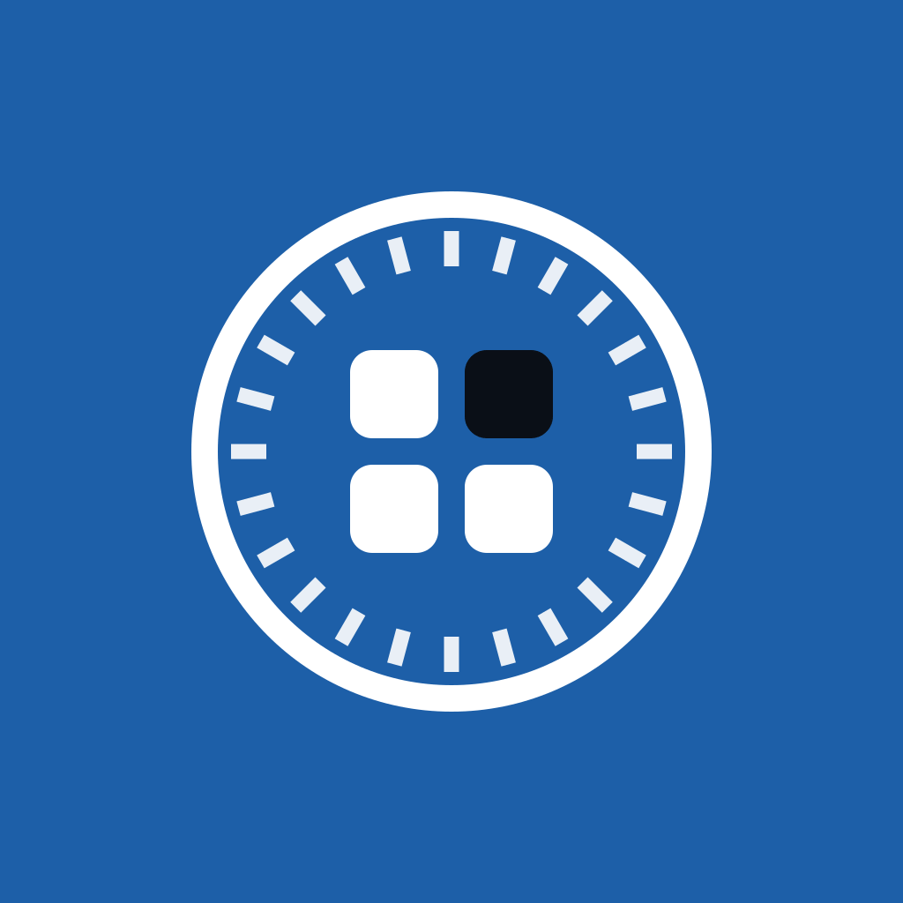
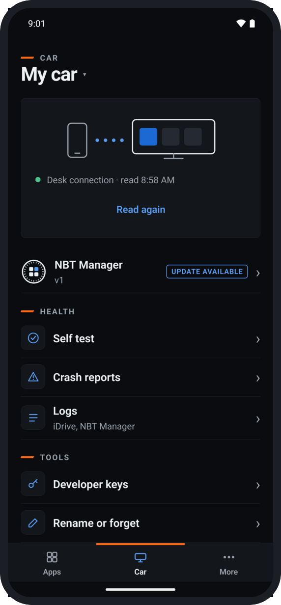
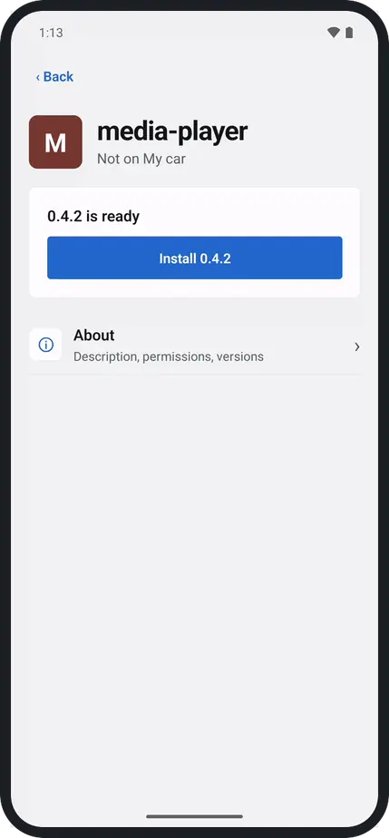
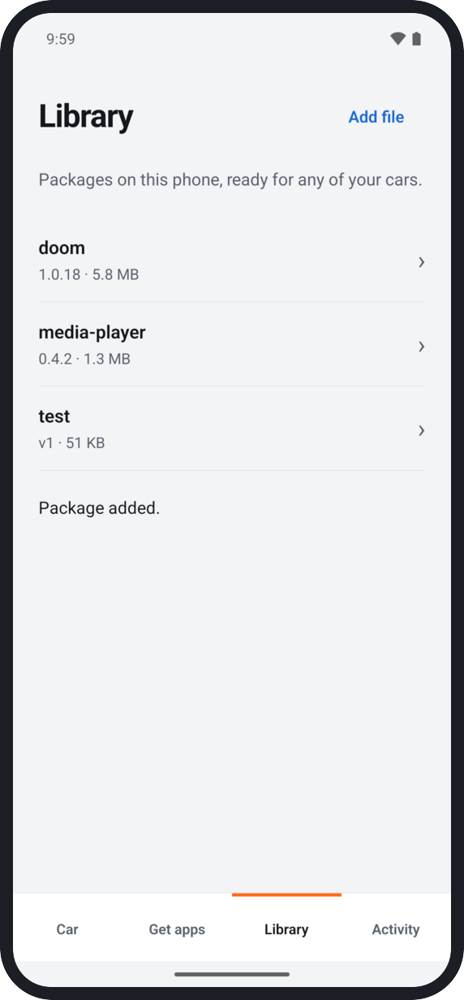
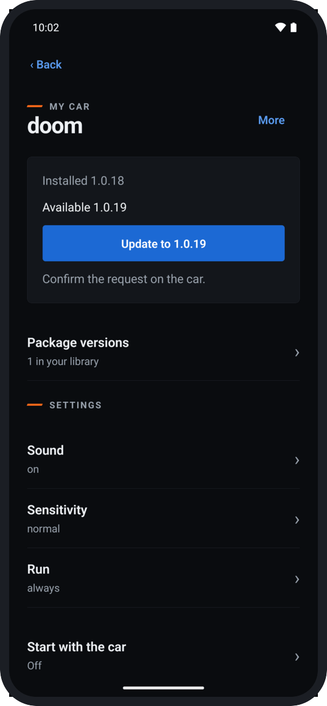
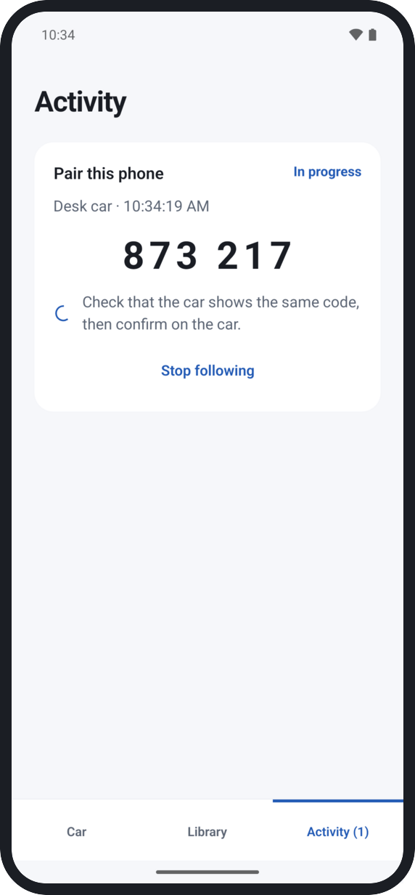
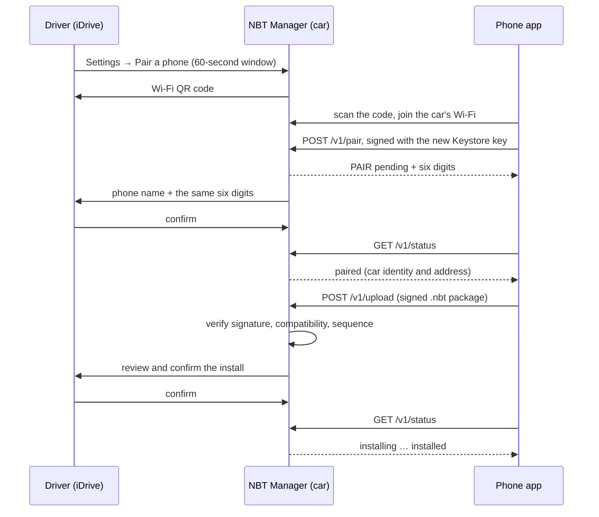

<p align="center">
  <picture>
    <source media="(prefers-color-scheme: dark)" srcset="docs/assets/logo-dark.svg">
    
  </picture>
</p>

<h1 align="center">
  <br>
  NBT Manager for Android
</h1>

<p align="center">
  <b>Your car's applications, from your phone.</b><br>
  Pair once, then install, update and configure; the driver approves on the car.
</p>

<p align="center">
  
</p>

The phone side of NBT Manager. Pair once per car, then install, update and
uninstall applications on the car's head unit and change their settings from
the phone. Every install and uninstall is confirmed by the driver on the car;
the phone never approves anything. On a car without NBT Manager, **Install NBT
Manager on a car** installs it over a Wi-Fi ENET adapter.

Expo SDK 58, React Native 0.88, Android 10 and later, application id
`net.cornera.nbtmgr`. In English, French, German, Italian, Spanish, Chinese and
Japanese, following the phone's language (English for any other); Language,
on the Car tab or Your cars, chooses one ([docs/ui.md](docs/ui.md)).

**Supported head units:** BMW NBT Evo (iDrive 6). Support for the earlier NBT
may come later.

Part of [NBTFoundry](https://github.com/NBTFoundry):
[manager](https://github.com/NBTFoundry/manager) (runs on the car) ·
[installer](https://github.com/NBTFoundry/installer) (desktop installer, shares its core) ·
[sdk](https://github.com/NBTFoundry/sdk) (application SDK) ·
[doom](https://github.com/NBTFoundry/doom) (example application)

Not affiliated with or endorsed by BMW AG. BMW, iDrive and NBT are trademarks of
BMW AG.

## In use

<table>
  <tr>
    <td width="25%" align="center"><br>
      <sub>Install: requested on the phone, approved on the car</sub></td>
    <td width="25%" align="center"><br>
      <sub>Library: packages kept on the phone for any car</sub></td>
    <td width="25%" align="center"><br>
      <sub>An application: update and live settings</sub></td>
    <td width="25%" align="center"><br>
      <sub>Pairing: the same six digits on phone and car</sub></td>
  </tr>
</table>

Captured from the debug build on an emulator against the desk car (below), with
synthetic packages: `python3 scripts/capture_screens.py`.

## How it works

The phone talks to the car's NBT Manager over the car's Wi-Fi with the paired-phone
HTTP protocol defined in `NBTFoundry/manager: PROTOCOL.md`. Each request is signed
with a P-256 key that never leaves the Android Keystore; the car checks the
signature and asks the driver to approve installs and uninstalls on the iDrive
screen.



The **manager installer** is the exception to car-side approval: it installs,
updates and removes NBT Manager itself over SSH through a Wi-Fi ENET adapter,
using the Rust installer core from `NBTFoundry/installer` (`mobile/`, through
UniFFI). It enables SSH on the head unit only after the user agrees, and asks
before removing.

## Setup

Node 24 with `corepack enable` (Yarn 4), JDK 17, Android SDK 36 (`ANDROID_HOME` set)
with an NDK, and Rust with `cargo install cargo-ndk` and
`rustup target add aarch64-linux-android`. Check out `NBTFoundry/installer` and
`NBTFoundry/manager` next to this repository, then:

```sh
yarn install --immutable
yarn installer-core    # the installer core (Rust) and its Kotlin binding
yarn prebuild          # generates android/ (not committed)
```

`yarn installer-core` (`scripts/build-installer-core.sh`) builds
`libnbt_installer.so` from `../installer` (or `$NBT_INSTALLER_SOURCE`) and generates
its UniFFI binding, both into `modules/car-install/android/generated/` (not
committed). A development build has no manager release inside, so Install and
Update are unavailable there; `--release` embeds one (`NBT_MANAGER_RELEASE`,
`NBT_MANAGER_PUBLIC_KEY`, which the manager's kit build sets). For the x86_64
emulator: `NBT_INSTALLER_ABIS="arm64-v8a x86_64" yarn installer-core`, and build
with `-PreactNativeArchitectures=x86_64`.

## Develop

Two kinds of build:

- **Dev client** for UI work: a debug build that loads JavaScript from Metro over
  the LAN. Install it once (`yarn android`); reinstall only after native changes
  (modules, config plugin, permissions). `yarn start` serves Metro on port 8082.
- **Release build** for the car (see below). Joining the car's Wi-Fi can take the
  phone off the LAN, which stops Metro.

**Emulator:** `yarn emulator` starts the first AVD (or `$NBT_AVD`) and waits for it
to boot; `yarn android:emulator` also builds and installs the dev client. The
emulator reaches the workstation at `10.0.2.2`.

**Desk car:** the manager's host worker and door running on the workstation, with
the car-side decisions typed in its terminal. It needs `managerd-test` from the
manager's host build (`make test` in `../manager`).

```sh
yarn desk --lan <workstation-address>       # NBT_MANAGER_DIR=../manager by default
```

If port 8080 is taken, add `--port 18080 --door-port 18081` (the door is always the
worker's port + 1) and enter `address:18080` in the app. In a debug build, Cars
shows *Pair the desk car*. Debug builds map the worker's loopback listener to that
address; release builds reach only `172.16.222.1` and `172.16.224.1`. In the desk
car's terminal: `PHONE OPEN` before pairing, then `confirm`, `decline`, `approve`,
`reject`, or `pack <app> <version> <sequence> [setting]` to make a signed test
package to add to the library.

## Test

```sh
yarn typecheck && yarn lint && yarn test
yarn test:contract
./android/gradlew -p android :car-link:testDebugUnitTest :device-key:testDebugUnitTest :app:assembleDebug
```

- Jest checks the protocol against the manager's signing vectors
  (`tests/fixtures/phone-signing-vectors.tsv`) and a fake car.
- `yarn test:contract` runs the TypeScript protocol with a software key over Node
  sockets against the real host worker and door (`scripts/host_car.py`,
  `NBT_MANAGER_BUILD` defaults to `../manager/build`).
- The Kotlin unit tests cover the route allow-list, the exact HTTP the car's parser
  accepts, reply bounds and the signing-text guard. The Keystore, Wi-Fi joining and
  socket binding need a phone.
- The installer's state is tested in Jest (`tests/installer.test.ts`); its Rust
  core in `NBTFoundry/installer` (`cargo test --workspace`).

## Release signing

Release builds use a dedicated keystore outside the repository, never the debug
key:

```sh
mkdir -p ~/.local/share/nbt-manager/keys/android && cd ~/.local/share/nbt-manager/keys/android
keytool -genkeypair -keystore nbt-manager-release.jks -alias nbt-manager -keyalg EC \
  -groupname secp256r1 -validity 10000 -dname "CN=NBT Manager"
chmod 600 nbt-manager-release.jks
keytool -list -v -keystore nbt-manager-release.jks -alias nbt-manager | grep SHA256
```

Keep a backup of the keystore and its password: an APK signed with another key
cannot update the installed app. Commit the certificate's SHA-256 in
`android-release-cert.sha256`. Then:

```sh
NBT_ANDROID_KEYSTORE_PASSWORD=… scripts/build-release.sh <version-code>
```

The script builds the installer core with `--release` first, so it needs the
release variables above (the manager's `tools/build_windows_kit.py` sets them,
with the kit's sequence as the version code). It refuses to run without the
keystore or the fingerprint file, and checks the APK's single signer against the
committed fingerprint. Installing a newer APK over an older one keeps the paired
cars; uninstalling the app deletes its keys, so each car must be paired again.

## Layout

| Path | Contents |
| --- | --- |
| `src/protocol/` | Signing text, pairing code, reply and package parsers, session, action flows |
| `src/car/` | Native link and signer, the action runner, user-facing messages |
| `src/store/` | Cars (SecureStore), library (app storage), activity |
| `src/screens/`, `src/ui/` | Screens and shared components ([docs/ui.md](docs/ui.md)) |
| `src/i18n/` | The texts in each language, the language shown and its detection |
| `src/installer/` | Manager installer session, state, tools and log panels |
| `modules/device-key/` | P-256 keys in the Android Keystore (Kotlin) |
| `modules/car-link/` | Wi-Fi join, allow-listed HTTP on the car network, file hashing (Kotlin) |
| `modules/car-install/` | The installer core through UniFFI; holds the adapter's Wi-Fi and mobile data (Kotlin) |
| `plugins/withCarApp.ts` | Backup off, network security config, Wi-Fi permissions |
| `scripts/` | Desk car, contract test, installer core, release build, README captures |
