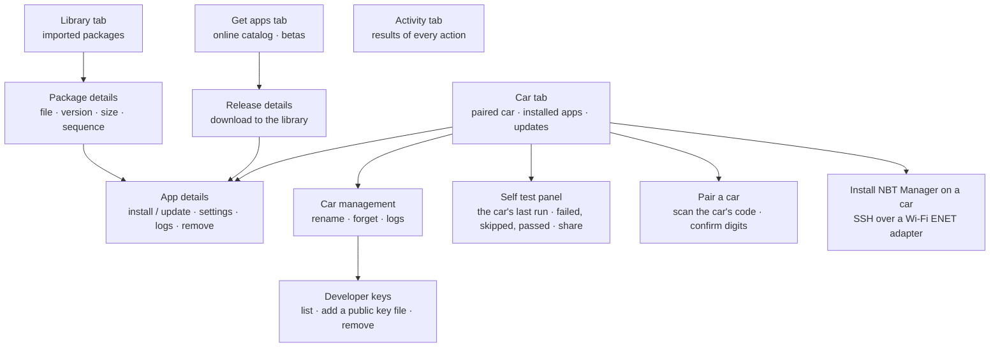

<!-- SPDX-License-Identifier: MPL-2.0 -->
# User interface

Four labelled tabs: **Car**, **Get apps**, **Library** and **Activity**. Car combines the paired
car and its applications. Car management, application details, pairing and the
manager installer open as pages with a header Back action. Android Back closes a
modal first, then returns to the parent page. The installer session keeps working
while its page is closed.

## Conventions

- The look is nbtfoundry.github.io's: near-black or light surfaces after the
  system appearance, one accent for actions and available updates, small
  capital labels after a slanted bar. Shared semantic colours cover text,
  input fields, logs, status and dialogs (`src/ui/palettes.ts`).
- Three themes, one per make: BMW (blue, an orange bar, square corners), MINI
  (blue, round) and Supra (orange-red, sharp). The app takes the selected car's, the
  one its own screen shows (the car's Settings › Theme, Automatic by its
  make): read with the application list (`GET /v1/theme`) and kept with the
  car. BMW's without a car, or with a manager that does not say.
- Each page gives its main action priority. Logs, rename, forget and application
  removal sit in context menus. Advanced installer tools stay folded.
- Cars and their cached applications load independently from package
  verification. Opening the app or Library makes no connection attempt; selecting
  a car, Connect, Refresh and car actions request the network.
- Get apps reads `https://nbtfoundry.github.io/catalog.json` over the phone's internet
  connection when it opens (kept 10 minutes) or on Refresh; nothing else goes online.
  A download lands in the library like a picked file, checked against the catalog's
  size and SHA-256; betas (pre-releases) show only when chosen. The car page tags an
  application *Update online* when the catalog has a newer release than the library.
- A package's details list its permissions as the car's review does: "Uses: …"
  and "Can: …" (`src/protocol/permissions.ts`, the manager's `docs/permissions.md`).
- An application list that could not be read has its own message; a successful
  empty list says that no applications are installed. The car page shows when the
  list was last read.
- App details offer the newest eligible package as the main install or update
  action. Equal and older sequences are shown for information. The car still
  checks its own high-water mark and decides whether to accept a file. NBT
  Manager releases use their own update flow: a release in a format the car
  does not read sends the user to the installer once.
- Settings load on request. Current values appear in rows, with the choices in a
  modal. Package details show file name, version, size, sequence and date added.
- Phone page (an installed application whose Library package declares
  `companion`): opened on request as an activity, then read every 2 s while
  shown, without an activity entry each; titles, texts, buttons, toggles,
  choices (in a modal) and progress bars as the application describes them
  (`src/protocol/companion.ts`, the manager's `docs/companion-bridge.md`). A
  malformed widget is left out. Taps go to the application, which decides what
  changes; the next read shows it.
- A Wi-Fi code another app hands over (`nbtmanager://pair?wifi=…`,
  `src/protocol/pairLink.ts`) opens Pair a car with it: "Pair with <network>"
  or "Scan a code instead"; nothing starts until the user taps.
- "What's new" (`src/whatsNew.ts`): a sheet once after an update whose list is
  newer than the last seen, kept in `preferences.json`; a new install starts
  without it.
- Pairing digits appear only while confirmation is pending. If the camera
  permission is denied for good, the app offers its settings page. Application
  installs and removals require approval on the car. The SSH manager installer
  keeps explicit SSH consent, a removal confirmation and one visible restart
  action.
- Developer keys (car management) list the keys the car trusts with their
  fingerprint. Adding one reads a public key file (PEM, RSA-3072) and shows the
  fingerprint the car will show; a file with a private key is refused before
  anything is sent. Adding and removing are confirmed on the car.
- Touch targets are at least 48 dp. Labels wrap, dialogs scroll, inputs stay
  reachable with the keyboard open, and status always includes text.
- English, French, German, Italian, Spanish, Chinese (Simplified) and Japanese
  (`src/i18n/`). Automatic follows the phone's language (React Native's
  `I18nManager` locale): Traditional Chinese shows Simplified, a language the
  app lacks (Dutch, Korean, ...) English. The Language row, on the Car tab
  before a car is paired and on Your cars, chooses one, kept in
  `preferences.json` in the app's storage. Each language is typed against the
  English keys; texts take `{name}` placeholders and counts a `.one` and an
  `.other` form (`tn`). Dates use the language shown. Activity entries keep the
  language they were written in. Application names, their settings and the
  car's own messages are shown as sent; the installer core's log stays English.

## State

Routing is local to `App.tsx`. Application pages keep their car id and reset local
state when the target changes. Car writes are serialized. Late application reads
merge into the current record, keeping a name change and never recreating a
forgotten pairing. A requested network release waits for the current action to
finish. Signed requests are queued; the car's network is held for 2 minutes after
the app goes to the background and 5 minutes without an action.
