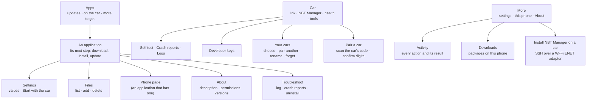

<!-- SPDX-License-Identifier: MPL-2.0 -->
# User interface

Three tabs, each an icon over a label: **Apps**, **Car**, **More**. Everything else is a
page over a tab, with a Back button; an application's page opens further pages. Android
Back closes a dialog first, then goes up one page, then to Apps, then leaves the app.
Without a paired car the app opens on Car, which pairs one.

## The screens

- **Apps** (`AppsScreen`, `store/appList.ts`): one list from the car, the downloads and the
  catalog. Each application appears once with its next step as a button: *Get* (download the
  newer release), *Install*, *Update*. Sections: updates (NBT Manager's too), on the car,
  more to get (downloaded ones first). The row opens the application's page.
- **An application** (`AppScreen`, `AppSections`): its icon, where it stands on the car, and
  one panel for the next step. The rest is behind rows. Settings, files and the phone page
  are read when their page opens.
- **Car** (`CarScreen`, `CarToolScreen`): the link (a drawing that moves while it is made),
  when the applications were read, NBT Manager's version and update, then Health and Tools.
  Self test and Crash reports show what was read last (`CarRecord.health`). The car's name
  opens Your cars.
- **More** (`MoreScreen`, `AboutCard`): Settings (language, appearance, theme, betas,
  diagnostics), When the app opens (connect to the car, check for new versions; both off),
  This phone (Activity, Downloads, Your cars, the installer), About (versions, the app's own
  update, links, Share details).
- **Activity bar** (`ActivityBar`): over the tabs while an action runs (its picture, a line
  for its progress) and after one failed, until Activity is opened.

## Conventions

- The look is nbtfoundry.github.io's: near-black or light surfaces, one accent for actions
  and updates, small capital labels after a slanted bar (`src/ui/palettes.ts`).
- Three themes, one per make: BMW (blue, an orange bar, square corners), MINI (blue, round)
  and Supra (orange-red, sharp). Theme "Like the car" takes the selected car's
  (`GET /v1/theme`, kept with the car), BMW's without one; or the user picks one.
  Appearance follows the phone, or is light or dark.
- Pictures: application icons are the website's, bundled (`yarn icons`, `src/ui/appIcons.ts`);
  an application without one shows its first letter. Line icons are drawn in `src/ui/icons.tsx`.
  Nothing is fetched for them.
- Motion (`src/ui/motion.tsx`, `src/ui/Lottie.tsx`): each movement says a state. Lottie
  animations (drawn by `yarn lottie`, painted in the theme's colours) show what an action is
  at: joining the car, sending, waiting for the driver, the car working, done, failed.
  Screens slide in; a list being read shows placeholder rows. With Android's "Remove
  animations", nothing moves.
- Progress is measured wherever there is something to measure: a download (the row's bar,
  the button filling), an install or a file being sent (the dialog's bar and percentage,
  the activity bar's line), the installer's steps.
- Going online: never by itself. The catalog and the app's own update are read when the user
  asks (Apps › Check for new versions or a pull on the list; More › About), or at start-up
  when the user turned that on. Diagnostics are the exception: on until turned off in
  More › Settings ([updates.md](updates.md)).
- The car: opening the app makes no connection. Reading its applications, an install, a
  setting or a tool page requests the network; Connect at start-up is the user's choice.
- A package's details list its permissions as the car's review does: "Uses: …" and
  "Can: …" (`src/protocol/permissions.ts`).
- The catalog (`https://nbtfoundry.github.io/catalog.json`) is kept; one read within a day
  can say *Up to date* (`listsNewest`). Betas (pre-releases) show only when chosen. A
  download is checked against the catalog's size and SHA-256 and lands in Downloads like a
  picked file; downloads run one at a time (`store/downloads.ts`).
- Installs, removals, pairing and developer keys are approved on the car, never on the
  phone. NBT Manager releases use their own update flow; from 0.5.2 the car starts the new
  one at once.
- Phone page (an installed application whose package declares `companion`): read every 2 s
  while shown; a malformed widget is left out (`src/protocol/companion.ts`).
- A Wi-Fi code another app hands over (`nbtmanager://pair?wifi=…`) opens Pair a car with it;
  nothing starts until the user taps.
- "What's new" (`src/whatsNew.ts`): once after an update that brings something, and again
  from About.
- Touch targets are at least 48 dp. Labels wrap, dialogs scroll, status always includes text.
- Seven languages (`src/i18n/`), following the phone's, English for any other; More ›
  Language chooses one. Each language is typed against the English keys; counts have a
  `.one` and an `.other` form (`tn`). Application names, their settings and the car's own
  messages are shown as sent; the installer core's log stays English.

## State

The route is state in `App.tsx` (`src/route.ts`: tab, page, application, section, tool).
A screen starts afresh when its route or the selected car changes. Car writes are
serialized; late reads merge into the current record and never recreate a forgotten
pairing. Signed requests are queued; the car's network is held for 2 minutes after the app
goes to the background and 5 minutes without an action. Preferences live in
`preferences.json`; a default is not written.
